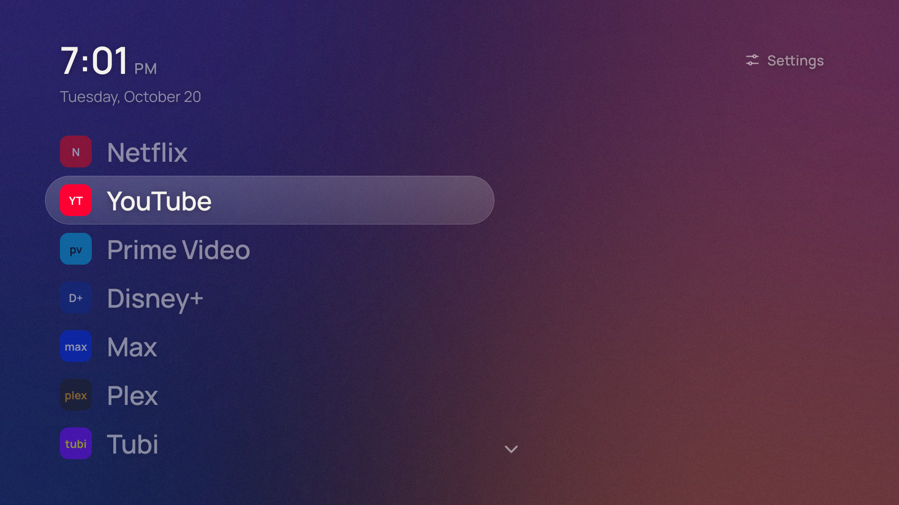
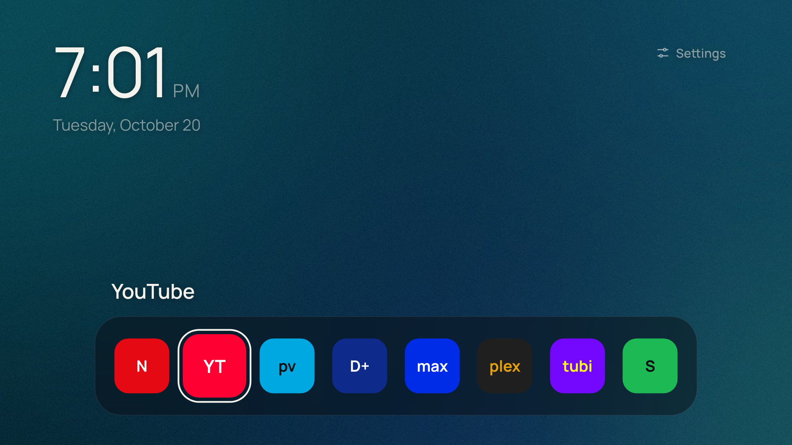
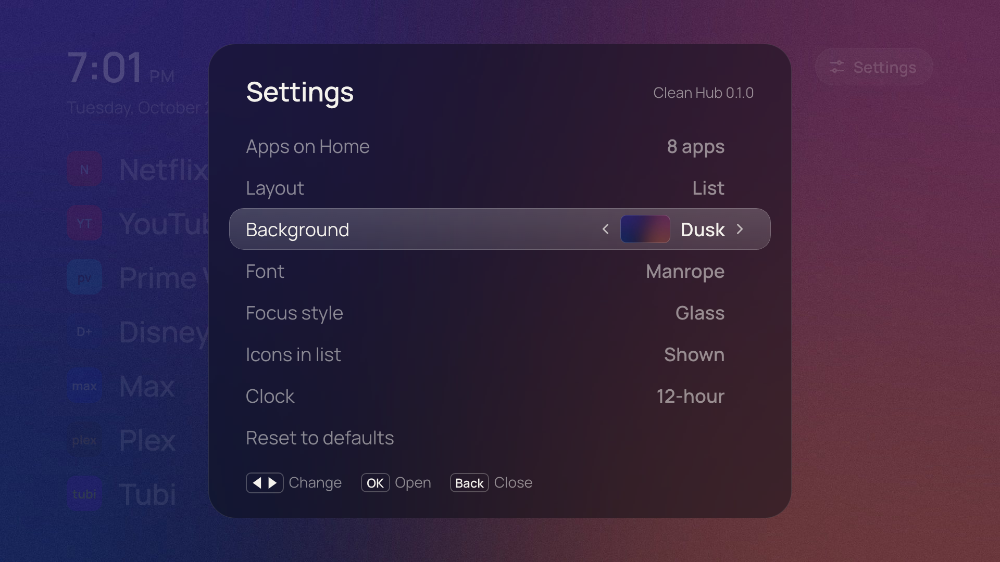
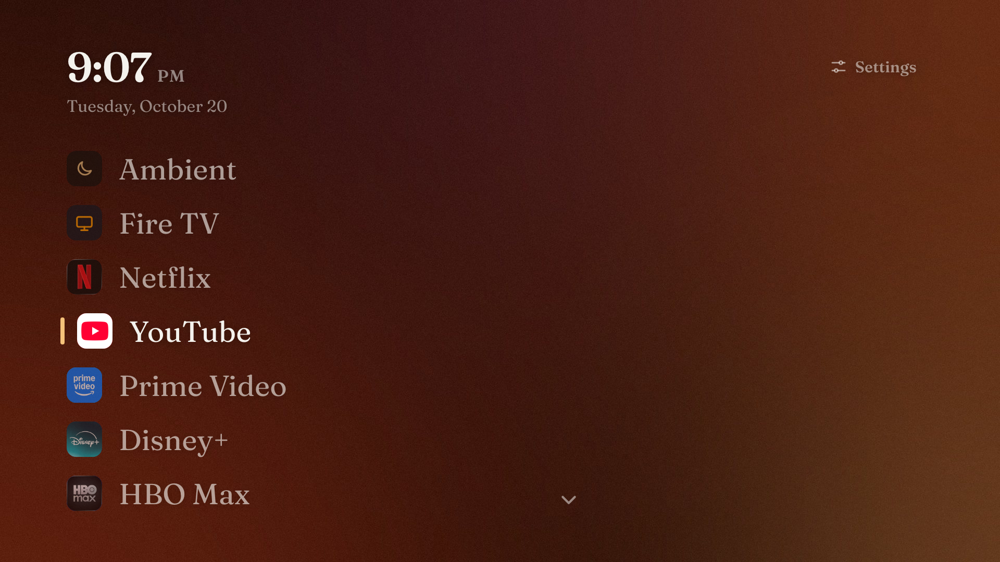
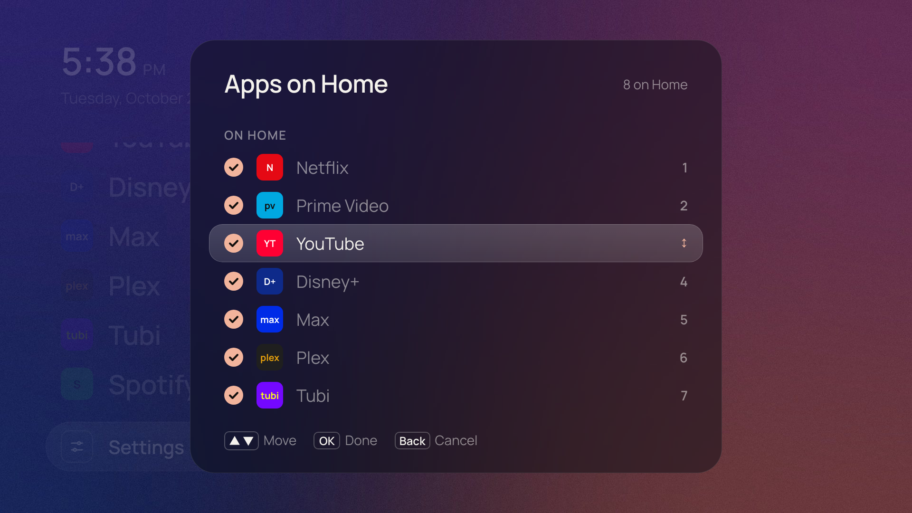
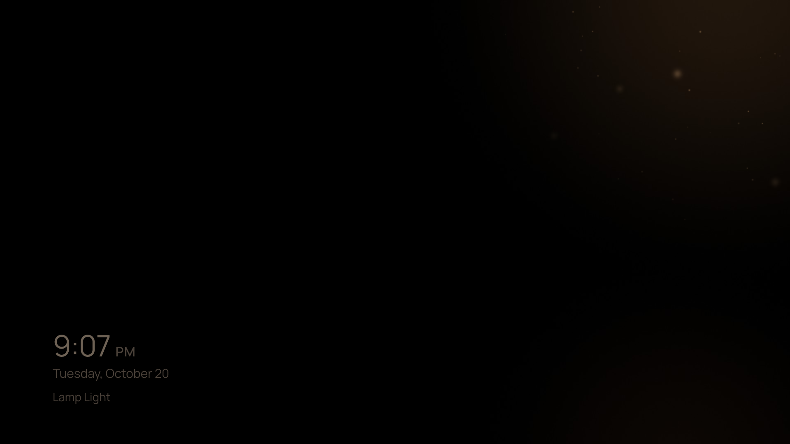

# Clean Hub

A quiet home screen for a Samsung Tizen TV, built for a 2022 **QN85B**
(`QN85QN85BDFXZA`, Tizen 6.5). It lists the streaming apps already installed on
the TV, lets you choose and order them, and opens them with the normal remote.

It is an ordinary Tizen web app (HTML, CSS and JavaScript) installed through
Samsung's Developer Mode. It does **not** root the TV, edit system files, or
change what the Home button does. Samsung's own apps and Smart Hub stay
exactly as they are.



| | |
| --- | --- |
|  |  |
|  |  |

## What you get

- **Two layouts.** A big-type list, or a dock of tiles with a large clock.
- **Ambient, first on Home.** A near-black, low-power wallpaper with a small
  dim clock and a loop of jazz, made to leave on all day (see
  [docs/TV-SETUP.md](docs/TV-SETUP.md#ambient-leaving-it-on-all-day)).
- **Fire TV on Home.** One press switches the TV to the Fire Stick's HDMI
  input, full screen, in about 0.3 s.
- **Settings is the button top right.** Press ▶ from the list, or ▲ from the
  dock; ◀, ▼ or Back returns to your app.
- **Your apps, your order.** Settings → Apps on Home. OK adds an app; on an
  app that's already on Home, OK picks it up, ▲▼ move it, OK drops it, and ◀
  removes it.
- **Five backgrounds** (Dusk, Tide, Ember, Night, Paper), **three fonts**
  (Manrope, Fraunces, Space Grotesk), **Glass or Type focus**, icons on or off,
  and a 12/24-hour clock or none.
- **Fast on the TV.** Backgrounds and their frosted "glass" copies are
  pre-rendered images, and focus moves only animate `transform` and `opacity`.
  Nothing blurs or repaints the full screen as you move.
- **Offline.** Fonts, images and music are bundled; the app makes no network
  requests.



### What it can't do

- **The Home button still opens Samsung's Smart Hub.** Remapping it needs
  root-level changes, which this project deliberately avoids. Clean Hub sits
  first in Samsung's app bar instead, so it's one press of OK after Home.
- **Starting on power-on depends on Samsung's "Autorun Last App".** The TV
  reopens whatever app you used last, so Clean Hub comes back only if it was
  the last app open when the TV went off.
- **Ads inside apps** (YouTube, Prime Video, etc.) are untouched; it only
  replaces the screen you pick apps from.
- **App icons:** the TV's own icons can't be trusted (on the QN85B, YouTube's
  is Tizen's placeholder pinwheel and Prime Video's won't load), so the apps
  Clean Hub recognises carry their own icon, from the app's App Store or
  Google Play listing (`python3 scripts/fetch-icons.py`, sources in
  `scripts/app-icons.json`). Other apps use the TV's icon, or a monogram tile
  when the TV won't hand one to a web app.
- **Tested on the QN85B itself** (Tizen 6.5): the app list, icons, launching,
  Ambient's music and the HDMI switch were checked live over the TV's
  debugger. If an app is ever missing, Settings → Apps on Home → *Show
  everything the TV lists* rescues it.

## Put it on the TV

See **[docs/TV-SETUP.md](docs/TV-SETUP.md)**. In short: turn on Developer Mode
on the TV with this Mac as the trusted host, then

```sh
python3 scripts/tv.py install-sdk --accept-license   # once
python3 scripts/tv.py setup                          # once; back up ~/.cleanhub
python3 scripts/tv.py install --tv <TV IP>
```

and pin Clean Hub first in Samsung's app bar.

## Try it on a computer

You need Node.js 20+.

```sh
npm install
npm run dev
```

Open <http://127.0.0.1:8777/frame>. Click the TV, then use the arrow keys,
**Enter** for OK and **Esc** for Back. The links at the top switch between a
typical TV, many apps, unknown apps, no apps, and a TV that refuses the app
list. The workbench fakes Tizen's app list and launcher; it never contacts a TV.

## Tests

```sh
npm test         # unit tests, browser-compatibility check, installer tests
npm run test:ui  # drives the real app in Chromium with remote keys
```

`npm run check` fails the build if the shipped code uses JavaScript newer than
ES2017, CSS the TV's Chromium may lack (flex `gap`, `inset`, `aspect-ratio`,
`min()/max()/clamp()`, `:focus-visible`, …), live `backdrop-filter`, or any
remote resource.

### Browser baseline

The checks assume Chromium 76 (Tizen 6.0), a little older than the QN85B's
engine, so the same build also runs on 2021 sets.

## Project layout

```
app/                the .wgt contents that ship to the TV
  config.xml        Tizen widget manifest
  index.html
  css/              app.css, fonts.css (generated)
  js/               catalog, options, store, apps, focus: pure logic
                    platform.js: the only file that calls `tizen`
                    ui.js: DOM; main.js: state and remote keys
  img/              backgrounds (generated); apps/: app icons (fetched)
  fonts/            Manrope, Fraunces, Space Grotesk (SIL OFL 1.1)
scripts/            build.mjs, tv.py (sign/install), asset generation, compatibility check
workbench/          desktop preview with a fake `tizen`
test/unit, test/ui  node:test suites
```

Regenerate assets with `python3 scripts/gen-backgrounds.py`,
`python3 scripts/fetch-icons.py` and `node scripts/vendor-fonts.mjs`;
refresh the README screenshots with `node scripts/screenshots.mjs`.

### The music

The five tracks in `app/music` ("Clean Hub Trio": *Lamp Light*, *Blue Hour
Walk*, *Quiet Harbor*, *Porch Blues*, *After Hours*, about 17 minutes) are
original. `python3 scripts/gen-jazz.py` composes and renders them (Rhodes,
vibraphone, upright bass, brushes) to AAC, so nothing needs licensing. The
script is seeded, so it rebuilds the same tracks every time. To use other
music, drop `.m4a` or `.mp3` files in `app/music` and list them in
`app/music/playlist.js`.

Ambient also carries ten **1920s recordings**, about 30 minutes. They are
U.S. public domain: under 17 U.S.C. §1401, recordings published before 1926
are free as of 2026, and every composition was published before 1931.
Settings → Ambient music chooses *All*, *Originals*, *1920s* or *Off*.
`python3 scripts/prepare-vintage.py` re-downloads them from Wikimedia Commons
and the Library of Congress National Jukebox, filters the 78-rpm rumble and
hiss, levels them, and encodes them to mono AAC in `app/music/vintage/`.

| Recording | Performers | Year | |
| --- | --- | --- | --- |
| Whispering | Paul Whiteman and His Ambassador Orchestra | 1920 | [source](https://commons.wikimedia.org/wiki/File:Paul_Whiteman_and_His_Ambassador_Orchestra_-_Whispering.flac) |
| Rose Room | Art Hickman's Orchestra | 1919 | [source](https://commons.wikimedia.org/wiki/File:%22Rose_Room%22_(1919),_by_Art_Hickman%27s_Orchestra.oga) |
| It Had to Be You | Isham Jones & His Orchestra | 1924 | [source](https://commons.wikimedia.org/wiki/File:Isham_Jones_%26_his_Orchestra_-_%22It_Had_to_Be_You%22_(1924).oga) |
| Somebody Loves Me | Paul Whiteman Orchestra | 1924 | [source](https://commons.wikimedia.org/wiki/File:Somebody_Loves_Me-Victor_19414-Paul_Whiteman_Orchestra.mp3) |
| What'll I Do | Paul Whiteman Orchestra | 1924 | [source](https://commons.wikimedia.org/wiki/File:What%27ll_I_do_(1924_sound_recording).mp3) |
| I'll See You in My Dreams | Isham Jones & Ray Miller's Orchestra | 1924 | [source](https://commons.wikimedia.org/wiki/File:I%27ll_See_You_In_My_Dreams_-_Isham_Jones_%26_Ray_Miller_Orch_(1924).ogg) |
| The St. Louis Blues | Bessie Smith with Louis Armstrong | 1925 | [source](https://commons.wikimedia.org/wiki/File:Bessie_Smith_and_Louis_Armstrong_-_The_St._Louis_Blues_(1925).mp3) |
| Down Hearted Blues | Bessie Smith | 1923 | [source](https://www.loc.gov/item/jukebox-670189/) |
| Muscle Shoals Blues | Fletcher Henderson's Orchestra | 1924 | [source](https://www.loc.gov/item/jukebox-673894/) |
| Copenhagen | The Wolverines with Bix Beiderbecke | 1924 | [source](https://commons.wikimedia.org/wiki/File:BixBeiderbecke-Copenhagen.ogg) |

## Licence

MIT for the code. Fonts are SIL Open Font License 1.1 (see `app/fonts/`).
Service names, colours and app icons identify the apps installed on your TV;
they belong to their owners.
